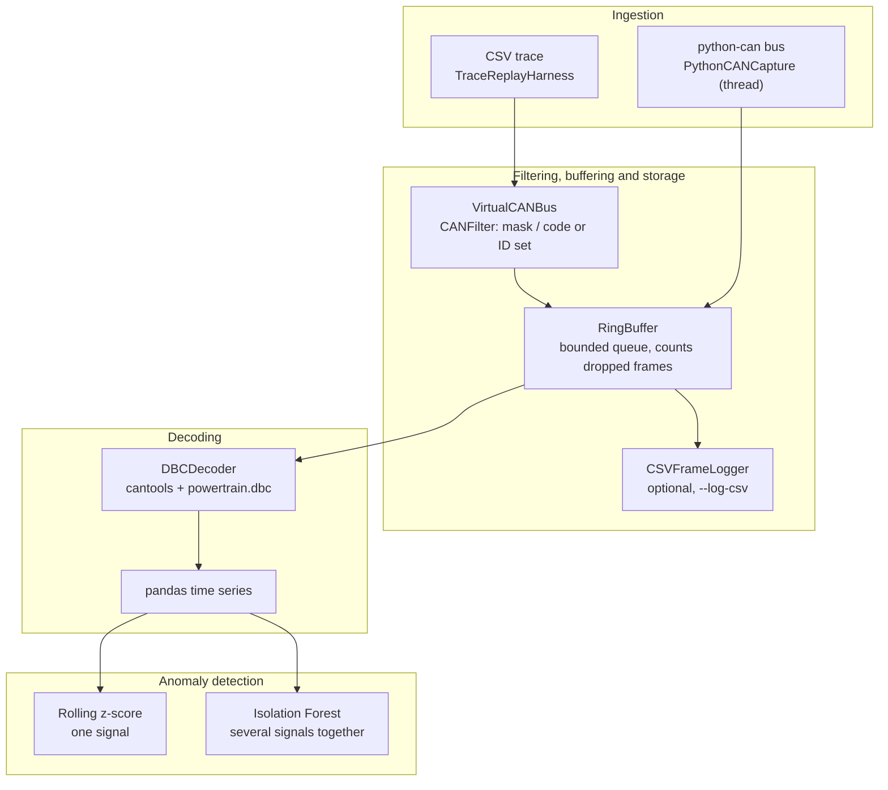

# CAN Bus Logger & Decoder

[](https://www.python.org/)
[](https://python-can.readthedocs.io/)
[](https://github.com/cantools/cantools)
[](https://scikit-learn.org/)
[](#testing)
[](LICENSE)

A Python prototype for capturing **Controller Area Network (CAN)** frames, decoding them into physical signals with a **DBC** file, and flagging implausible telemetry with a **rolling z-score** and an **Isolation Forest**.

It replays recorded traces into a simulated bus (or reads from any `python-can` interface), buffers frames in a bounded queue that **counts every drop**, logs raw frames to CSV, and turns decoded signals into a pandas time series. It is a learning prototype built to explore the full path from raw frame to analysed signal. See [Limitations](#limitations) for what it does not do yet.

---

## Architecture



| Stage | What it does |
| :--- | :--- |
| **Capture** | Frames come from a CSV trace replayed into `VirtualCANBus`, or from a real `python-can` bus read by a background thread. |
| **Filter and buffer** | `CANFilter` imitates a CAN controller's acceptance filter. Accepted frames enter a bounded `RingBuffer`; when it is full the newest frame is dropped and counted. |
| **Decode** | `DBCDecoder` turns the raw bytes of each frame into named signals using a `.dbc` file. |
| **Analyse** | A rolling z-score watches one signal for spikes; an Isolation Forest watches engine speed, throttle and load together. |

---

## How decoding works

A classic CAN frame carries an **11-bit (standard) or 29-bit (extended) identifier**, a 4-bit length code and **0–8 data bytes**, followed by a CRC and an acknowledge slot. The identifier says what the message is; the DBC file says how to read its bytes:

$$\text{physical value} = (\text{raw value} \times \text{factor}) + \text{offset}$$

Example from `data/powertrain.dbc`:

```text
BO_ 256 EngineData: 8 Engine
 SG_ EngineSpeed : 0|16@1+ (0.25,0) [0|8000] "rpm" Gateway
```

`EngineSpeed` starts at bit 0, is 16 bits long, little-endian, unsigned, factor 0.25. A frame with ID `0x100` and payload `64 19 ...` gives raw `0x1964 = 6500`, so the speed is `6500 × 0.25 = 1625 rpm`.

If `cantools` or the DBC file is unavailable, a built-in fallback decodes the four messages of the included DBC.

---

## Components

| Module | Responsibility |
| :--- | :--- |
| `can_logger/core.py` | `CANFrame`, `CANFilter`, `RingBuffer`, `VirtualCANBus` |
| `can_logger/decoder.py` | DBC decoding and time-series construction |
| `can_logger/anomaly_detector.py` | Rolling z-score and Isolation Forest detectors |
| `can_logger/replay_harness.py` | Load a CSV trace and replay it into a bus |
| `can_logger/storage.py` | Write captured frames to CSV |
| `can_logger/python_can_adapter.py` | Read from a `python-can` bus into the `RingBuffer` |
| `can_logger/pipeline.py` | The full flow in one function, returning a result object |
| `can_logger/benchmark.py` | Throughput and decode-latency measurement |
| `data/powertrain.dbc` | 4 messages, 10 signals: engine, vehicle speed, thermal, brake |
| `data/sample_trace.csv` | 25 frames with two injected anomalies |
| `main.py` | Command line entry point |

---

## Quickstart

```bash
git clone https://github.com/Doufless1/can-bus-logger-decoder.git
cd can-bus-logger-decoder
python -m venv venv
source venv/bin/activate        # Windows: venv\Scripts\activate
pip install -r requirements.txt
```

Replay the sample trace, decode it and run the anomaly checks:

```bash
python main.py --trace data/sample_trace.csv --dbc data/powertrain.dbc
```

Output (excerpt):

```text
[INFO] Replayed 25 frames into the virtual bus
[INFO] Captured 25 frames, decoded 25 into the time series

TELEMETRY CHANNEL BREAKDOWN:
* Message 'EngineData': 8 frames captured
  |-- Mean RPM: 2050.8 rpm (Max: 4800.0 rpm)
* Message 'VehicleSpeed': 8 frames captured
  |-- Mean Speed: 44.0 km/h (Max: 51.52 km/h)
* Message 'ThermalStatus': 8 frames captured
  |-- Mean Coolant Temp: 97.9 deg C (Max: 145.0 deg C)
* Message 'BrakeStatus': 1 frames captured
  |-- Brake Applied State: 0

ANOMALY DETECTION:
  [ALERT] Signal 'CoolantTempC' spiked to 145.0 (z-score: 54.2) at timestamp 0.0550s
  [ALERT] Implausible correlation detected: EngineSpeed=4800.0, ThrottlePosition=0.0, EngineLoad=58.8 at timestamp 0.0610s

[STATUS] Frames received: 25, dropped: 0
```

### Command line options

| Option | Default | Description |
| :--- | :--- | :--- |
| `--trace` | `data/sample_trace.csv` | CSV trace to replay |
| `--dbc` | `data/powertrain.dbc` | DBC database used for decoding |
| `--speed` | `100` | Replay speed multiplier |
| `--z-threshold` | `2.0` | Z-score threshold for outliers |
| `--buffer-capacity` | `50000` | Ring buffer size in frames |
| `--log-csv` | off | Also save the captured raw frames to this CSV file |

Try `--buffer-capacity 5` to see the drop counter report `dropped: 20` on the sample trace.

### Reading from a `python-can` bus

```python
import can
from can_logger.core import RingBuffer
from can_logger.python_can_adapter import PythonCANCapture

buffer = RingBuffer(capacity=50000)
bus = can.Bus(interface="virtual", channel="demo")   # on Linux: interface="socketcan", channel="vcan0"
capture = PythonCANCapture(bus, buffer)
capture.start()
# frames arrive in `buffer`; read them with buffer.pop()
capture.stop()
```

The adapter is tested against python-can's built-in `virtual` interface. SocketCAN uses the same python-can API but has not been tested against `vcan0` or real hardware.

---

## Anomaly detection

| Detector | Input | How it works |
| :--- | :--- | :--- |
| **Rolling z-score** | `CoolantTempC` | Compares each value with the mean and standard deviation of the 5 preceding values (standard deviation floored at 1.0). Flags the value when the absolute z-score exceeds the threshold. |
| **Isolation Forest** | `EngineSpeed`, `ThrottlePosition`, `EngineLoad` | Unsupervised: isolates rows that need few random splits. Fitted on the trace being analysed; the default contamination of 0.1 flags roughly the 10% most unusual rows (never fewer than 5%). |

The Isolation Forest will flag something even in clean data, so read its output as "most unusual samples", not as proof of a fault.

---

## Testing

```bash
pytest
```

| Test file | Covers |
| :--- | :--- |
| `test_can_decoder.py` | Ring buffer push/pop, ID filter, decoding of engine and thermal frames (built-in fallback decoder) |
| `test_anomalies.py` | Z-score spike detection, multivariate fault detection |
| `test_core.py` | Drop statistics, configurable buffer capacity |
| `test_replay_harness.py` | Payloads made only of digits keep their leading zeros |
| `test_storage.py` | CSV logger round trip, including an extended 29-bit ID |
| `test_pipeline.py` | End to end on the sample trace, real drop count, anomaly results, CSV logging |
| `test_python_can_adapter.py` | Message conversion, capture thread on a virtual bus |
| `test_benchmark.py` | Every frame is accounted for (decoded + dropped = sent) |
| `test_alert_text.py` | Alert text shows rounded values |

---

## Performance

```bash
python -m can_logger.benchmark --frames 100000
```

A producer thread pushes frames into the bus while a consumer thread decodes them. The script reports frames sent, decoded and dropped, throughput, and p50/p99 latency of the decode step. It measures the in-process pipeline, not a physical bus, so results depend on the machine it runs on.

---

## Limitations

- The bus is simulated in Python. Capture from a physical CAN interface goes through `python-can` and is untested on hardware.
- Replay reads the whole CSV and replays it in a single thread, sleeping between frames (timing is approximate, each gap capped at 50 ms). Only the benchmark and `PythonCANCapture` use extra threads.
- The `RingBuffer` is a bounded `queue.Queue`: it uses a lock and drops the newest frame when full.
- Input and output are CSV only. There is no ASC, BLF, MDF4 or Parquet support.
- `replay_to_bus(inject_fault=True)` corrupts one frame in the middle of the trace; it is not exposed on the command line.
- The decoder is tested on classic CAN frames (up to 8 bytes). CAN FD and J1939 are not handled.
- The sample trace is only 25 frames long.

## Roadmap

- [ ] Test capture against a real `vcan0` on Linux, then against hardware
- [ ] Write logs in ASAM MDF4 and compare size and speed with CSV
- [ ] J1939 decoding (PGN, source address) and CAN FD frames
- [ ] Send decoded data to a cloud endpoint over MQTT with TLS

---

## License

Released under the [MIT License](LICENSE).
