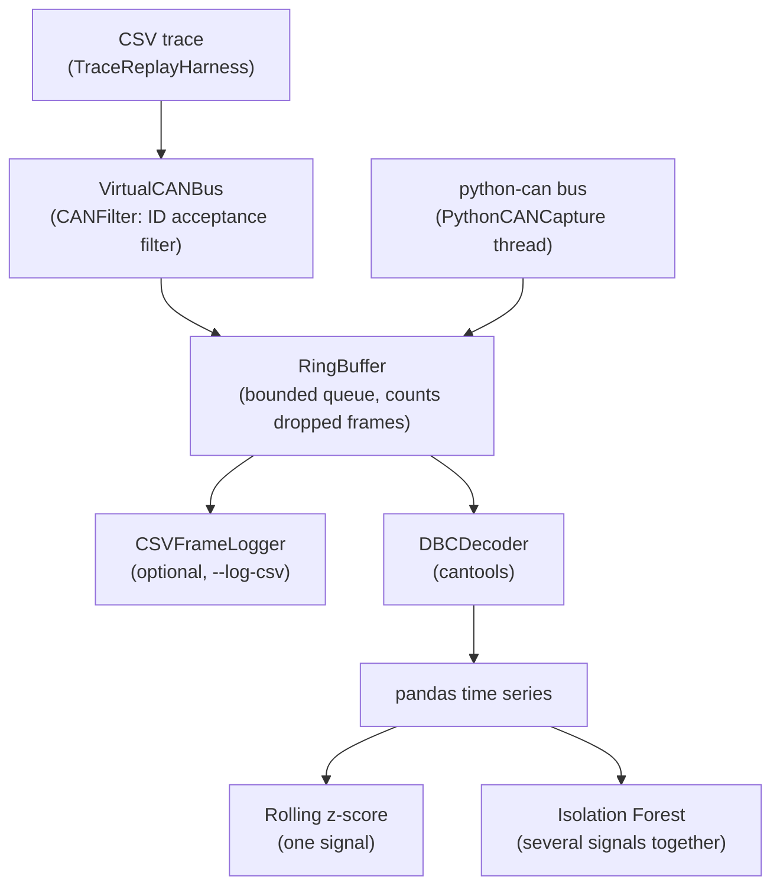

# CAN Bus Logger & Decoder Prototype

[](https://www.python.org/)
[](LICENSE)

A small Python prototype that I built to learn how CAN data is captured, decoded and checked. It replays a recorded CAN trace into a simulated bus, buffers the frames, decodes them into physical signals with a DBC file, and flags unusual values with a rolling z-score and an Isolation Forest.

It is a learning prototype, not a production logger. See [Limitations](#limitations) for exactly what it does and does not do.

## How it works



1. **Capture.** Frames come either from a CSV trace replayed into `VirtualCANBus`, or from a real `python-can` bus read by a background thread (`PythonCANCapture`).
2. **Filter and buffer.** `CANFilter` imitates a CAN controller's acceptance filter (mask and code, or a set of allowed IDs). Accepted frames go into a bounded `RingBuffer`. When it is full, the newest frame is dropped and counted.
3. **Decode.** `DBCDecoder` uses `cantools` and a `.dbc` file to turn the raw bytes of each frame into named signals: `physical value = raw value × factor + offset`. If `cantools` or the DBC file is unavailable, a built-in fallback decodes the four messages of the included DBC.
4. **Analyse.** Decoded frames become a pandas time series. A rolling z-score looks for spikes in one signal (coolant temperature). An Isolation Forest looks at engine speed, throttle and engine load together.

A classic CAN frame carries an 11-bit (standard) or 29-bit (extended) identifier, a 4-bit length code and 0–8 data bytes, followed by a CRC and an acknowledge slot. The identifier says what the message is, and the DBC file says how to read its bytes.

## Project layout

```text
can_logger/
  core.py                 CANFrame, CANFilter, RingBuffer, VirtualCANBus
  decoder.py              DBC decoding and time-series building
  anomaly_detector.py     rolling z-score and Isolation Forest
  replay_harness.py       load a CSV trace and replay it into a bus
  storage.py              write captured frames to CSV
  python_can_adapter.py   read from a python-can bus into the RingBuffer
  pipeline.py             the whole flow in one function
  benchmark.py            throughput and decode-latency measurement
data/
  powertrain.dbc          4 messages, 10 signals (engine, speed, thermal, brake)
  sample_trace.csv        25 frames with two injected anomalies
tests/                    pytest suite
main.py                   command line entry point
```

## Usage

```bash
git clone https://github.com/Doufless1/can-bus-logger-decoder.git
cd can-bus-logger-decoder
python -m venv venv
source venv/bin/activate        # Windows: venv\Scripts\activate
pip install -r requirements.txt
```

Replay the sample trace, decode it and run the anomaly checks:

```bash
python main.py --trace data/sample_trace.csv --dbc data/powertrain.dbc
```

Options: `--speed` (replay speed multiplier, default 100), `--z-threshold` (default 2.0), `--buffer-capacity` (default 50000 frames) and `--log-csv PATH` (also save the captured raw frames). The final line reports the real number of frames received and dropped.

Run the tests:

```bash
pytest
```

### Measure throughput on your machine

```bash
python -m can_logger.benchmark --frames 100000
```

A producer thread pushes frames into the bus while a consumer thread decodes them. The script prints frames sent, decoded and dropped, throughput, and p50/p99 latency of the decode step. It measures the in-process pipeline only, not a physical bus, so the results depend entirely on your hardware.

### Reading from a python-can bus

```python
import can
from can_logger.core import RingBuffer
from can_logger.python_can_adapter import PythonCANCapture

buffer = RingBuffer(capacity=50000)
bus = can.Bus(interface="virtual", channel="demo")   # on Linux: interface="socketcan", channel="vcan0"
capture = PythonCANCapture(bus, buffer)
capture.start()
# ... frames arrive in `buffer`; read them with buffer.pop()
capture.stop()
```

The adapter is tested against python-can's built-in `virtual` interface. SocketCAN uses the same python-can API, but I have not tested it against `vcan0` or real hardware.

## Anomaly detection details

- **Rolling z-score** compares each value with the mean and standard deviation of the 5 preceding values (window 5, standard deviation floor of 1.0). A value is flagged when |z| exceeds the threshold. It is applied to `CoolantTempC` only.
- **Isolation Forest** is fitted on the trace being analysed, with no separate training set. With the default contamination of 0.1 it flags roughly the 10% most unusual rows (and never fewer than 5%), so it will flag something even in clean data. Treat its output as "most unusual samples", not as proof of a fault.

## Limitations

- The bus is simulated in Python. Capture from a physical CAN interface goes through python-can and is untested on hardware.
- Replay reads the whole CSV and replays it in a single thread, sleeping between frames (timing is approximate, and each gap is capped at 50 ms). Only the benchmark and `PythonCANCapture` use extra threads.
- The RingBuffer is a bounded `queue.Queue`: it uses a lock and drops the newest frame when full.
- Input and output are CSV only. There is no ASC, BLF, MDF4 or Parquet support.
- `replay_to_bus(inject_fault=True)` corrupts a single frame in the middle of the trace; it is not exposed on the command line.
- The decoder is tested on classic CAN frames (up to 8 bytes). CAN FD and J1939 are not handled.
- The sample trace is only 25 frames long.

## Ideas for next steps

- Test capture against a real `vcan0` on Linux, then against hardware.
- Write logs in ASAM MDF4 and compare the size and speed with CSV.
- Add J1939 (PGN and source address) decoding and CAN FD frames.
- Send decoded data to a cloud endpoint over MQTT with TLS.

## License

Released under the [MIT License](LICENSE).
